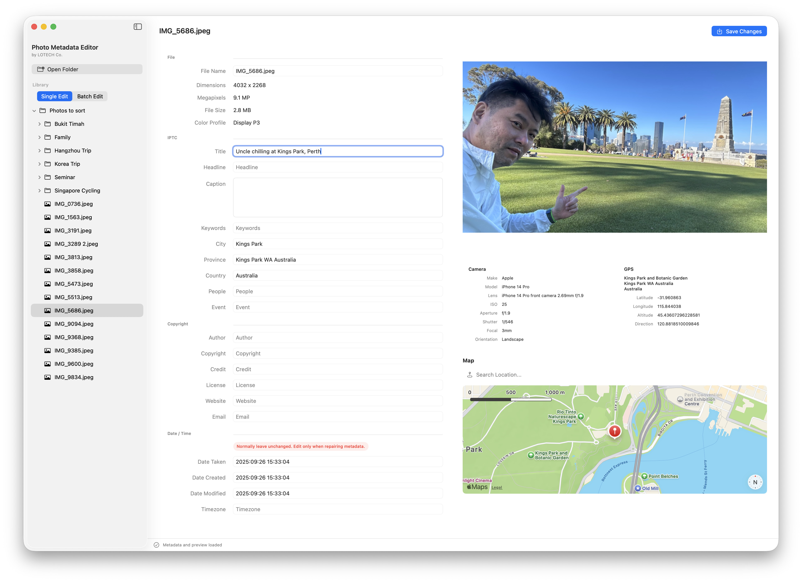
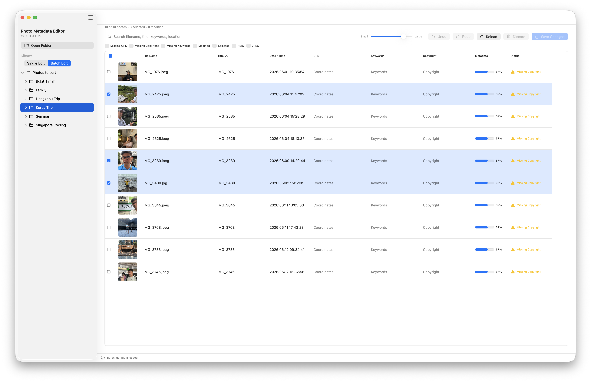
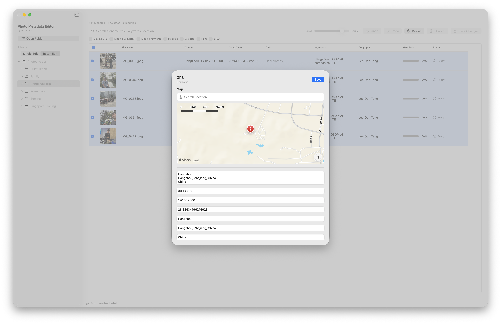

# LOTECH Photo Metadata Editor

Organise years of photos without wrestling with metadata.

- **Current Version:** 1.0.0
- **Platform:** macOS 14+
- **License:** MIT

A lightweight macOS application for viewing, organising and editing photo metadata, whether we're working on a single image or thousands of photos at a time.

LOTECH combines detailed single-photo editing with a spreadsheet-style Batch Edit interface, making large photo collections practical to organise without expensive Digital Asset Management (DAM) software.

---

# Less software. More memories.

Photos quietly carry information we rarely think about.

Sometimes the camera gets it wrong.

Sometimes the date is missing.

Sometimes the GPS location isn't accurate.

Sometimes we simply want to organise years of family memories.

Editing that information shouldn't require learning technical standards, command-line tools or uploading our photos to another service.

We built LOTECH Photo Metadata Editor because organising our memories should feel simple again.

Technology can deal with the technical details.

We shouldn't have to.

---

# Download

LOTECH Photo Metadata Editor requires **macOS 14 Sonoma or later**.

### Latest Release

- [Latest Release page](https://github.com/oonteng/lotech-photo-metadata-editor/releases/latest)
- [Apple Silicon build](https://github.com/oonteng/lotech-photo-metadata-editor/releases/download/v1.0.0/LOTECH.Photo.Metadata.Editor.ARM64.v1.0.0.zip) — Recommended for M1, M2, M3, M4 and later Macs
- [Universal build](https://github.com/oonteng/lotech-photo-metadata-editor/releases/download/v1.0.0/LOTECH.Photo.Metadata.Editor.Universal.v1.0.0.zip) — Works on both Apple Silicon and Intel Macs
- [Release Notes](https://github.com/oonteng/lotech-photo-metadata-editor/releases/tag/v1.0.0)

### SHA-256 Checksums

- **Apple Silicon:** `e1e57ab42df53e18fb029abb24440927d5ebc0d176d4c5ca139eac6df76009ee`
- **Universal:** `d2aba1b27a71df3c2c7642eb2bca26657e8f29d86ce00cf2c9920b4929df845b`

### Installation

1. Download the appropriate ZIP file.
2. Double-click the ZIP file to extract **LOTECH Photo Metadata Editor.app**.
3. Move the application into the **Applications** folder.
4. Launch **LOTECH Photo Metadata Editor**.

The downloadable builds are signed with **LOTECH's Apple Developer ID** and notarized by Apple for normal Gatekeeper verification.

---

# We think about memories. Not metadata.

When we look at a photograph, we don't think:

*"Is this EXIF?"*

*"Is this IPTC?"*

*"Is this XMP?"*

Most of us simply want to know:

- What is this photo?
- When was it taken?
- Where was it taken?
- Who was there?
- Why did we keep it?

LOTECH presents metadata the way we naturally think about our photos.

Behind the scenes, the application quietly reads and writes the appropriate metadata standards while presenting one consistent editing experience.

---

# Edit like a spreadsheet

This is probably our favourite feature.

Editing metadata shouldn't mean opening one photo, making a change, clicking **Save**, opening the next photo, and repeating the same process hundreds of times.

Instead, LOTECH lets us edit an entire folder the same way many of us already work every day — like a spreadsheet.

Most of us grew up using Word, Excel and PowerPoint. Tables feel natural. We can scan hundreds of rows, copy and paste values, fill down columns and make changes quickly.

So why are we still editing metadata one photograph at a time through endless forms and dialog boxes?

We'd rather see everything in one place, make the changes, press **Save**, and move on with life.

Simple.

Fast.

Familiar.

---

# Single Edit

Sometimes we only need to work on one photograph.

Single Edit lets us edit metadata while viewing the actual image, making it easy to understand exactly what we're working on.

### Features

- Large photo preview
- Camera information
- GPS information
- Interactive Apple Maps preview
- GPS editing using map search and draggable pin
- Metadata validation
- Metadata completeness indicator

### Editable metadata

- Title
- Headline
- Caption
- Keywords
- People
- Event
- City
- Province
- Country
- Author
- Copyright
- Credit
- License
- Website
- Email
- Date & Time
- GPS coordinates

---

# Batch Edit

Managing hundreds or even thousands of photos shouldn't feel like repetitive office work.

Batch Edit provides a spreadsheet-style workflow designed to help us organise large collections efficiently.

### Features

- Thumbnail preview
- Multi-selection
- Spreadsheet editing
- Batch rename
- Batch GPS editing
- Batch keyword editing
- Batch copyright editing
- Batch date editing
- Search
- Filters
- Undo / Redo
- Metadata completeness tracking
- Missing metadata indicators

GPS editing follows the same workflow.

Select multiple photos.

Search for a location.

Confirm it on Apple Maps.

Apply the location to every selected image together.

The goal is simple.

Make hundreds of metadata edits feel like editing a spreadsheet.

---

# The technical details are still there

Sometimes we do want to inspect aperture, shutter speed, ISO, focal length, lens information, GPS coordinates or every piece of metadata hidden inside the image.

No problem.

LOTECH doesn't hide the technical information.

We simply choose not to overwhelm us with everything the moment we open a photo.

The information is there when we need it, and quietly stays out of the way when we don't.

---

# Built by someone who had the same problem

This software exists because we had years of photos.

Family photos.

Travel photos.

Client photos.

Screenshots.

Drone photos.

Phone photos.

Camera photos.

We wanted a better way to organise them.

So we built one.

If it quietly helps someone else organise their own memories too, we've achieved what we set out to do.

---

# Local First

Our photos stay on our computer.

Metadata editing happens locally.

No cloud processing.

No subscriptions.

No accounts.

Our photo library stays exactly where it belongs.

Future AI-assisted features, if introduced, will always remain optional.

---

# Technical Details

LOTECH Photo Metadata Editor supports the metadata standards used by modern cameras, operating systems and photo management software.

### Supported metadata

- EXIF
- IPTC
- XMP
- GPS metadata
- Keywords
- Ratings
- Copyright
- Camera information
- Lens information
- Date & Time
- Custom metadata (where supported)

Metadata is written directly into the image files using open standards, making them compatible with applications such as:

- Adobe Lightroom
- Adobe Bridge
- Apple Photos
- digiKam
- XnView MP
- Windows Explorer
- and many other applications that support standard photo metadata.

---

# Current Status

Current release includes:

- Single Edit
- Spreadsheet-style Batch Edit
- Interactive GPS editing
- Apple Maps integration
- Batch rename
- Undo / Redo
- Metadata validation
- Metadata completeness tracking

---

# Known Limitations

- Writable metadata depends on the image format.
- Different applications support different metadata standards.
- Always keep backups before performing large batch operations.

---

# Roadmap

Future directions include:

- Additional metadata standards
- RAW format support
- Optional AI-assisted metadata suggestions
- Face recognition integration
- LOTECH Metadata Engine
- LOTECH AI SDK integration

---

# About LOTECH

LOTECH builds practical software that quietly removes friction from everyday work.

We quietly solve annoying problems that many of us have simply learned to live with.

Instead of adding more technology, we try to make technology disappear into the background so we can focus on the work itself.

We don't build software to impress people.

We build software that quietly helps us finish the job.

---

# Part of the LOTECH family

LOTECH Photo Metadata Editor is part of a growing collection of focused, local-first tools built around the same philosophy.

Current projects include:

- [LOTECH Photo Metadata Editor](https://github.com/oonteng/lotech-photo-metadata-editor)
- [LOTECH Audio Metadata Editor](https://github.com/oonteng/lotech-audio-metadata-editor)
- LOTECH Text Editor

More focused tools are on the way.
